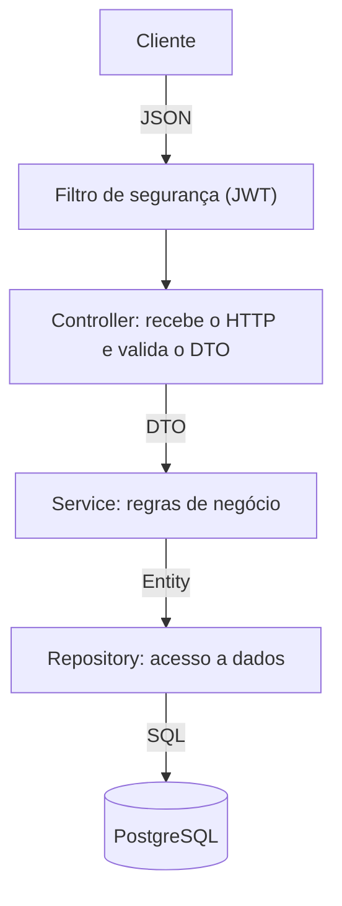
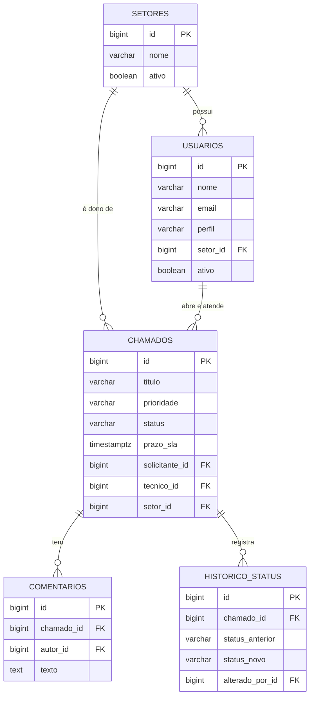
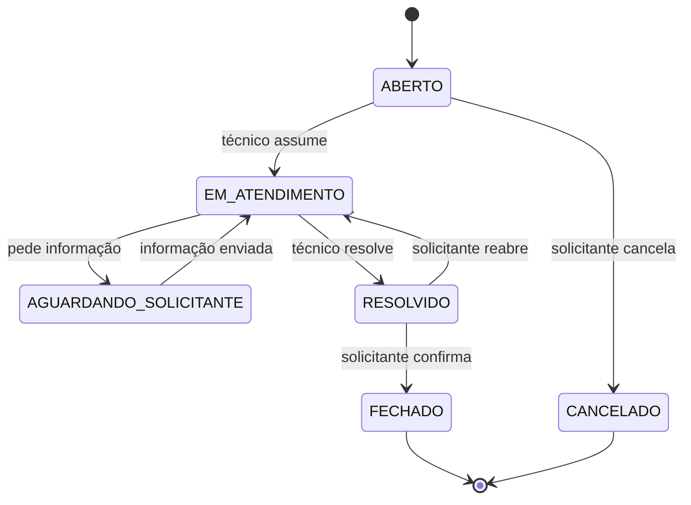

# HelpDesk API


API REST de uma central de chamados internos (Help Desk) para empresas de médio e grande porte. Funcionários abrem chamados, o setor responsável atende e cada chamado tem um prazo de atendimento (SLA) calculado pela prioridade.

> Projeto de estudo e portfólio, construído em fases e com o código escrito à mão para consolidar os fundamentos de Java e Spring Boot.

## Funcionalidades

- Cadastro de setores (TI, RH, Financeiro...) e usuários com perfis
- Abertura de chamados com prioridade e prazo de SLA automático
- Listagem com filtros e paginação, ordenada pelo prazo
- Fluxo de status controlado: o chamado só avança pelas transições permitidas
- Comentários entre solicitante e técnico
- Histórico completo de mudanças de status, para auditoria
- Login com JWT e permissões por perfil
- Relatório para o gestor: chamados por status e setor, % dentro do SLA

### Perfis

| Perfil | O que pode fazer |
| --- | --- |
| Solicitante | Abrir, acompanhar e comentar os próprios chamados |
| Técnico | Atender os chamados do seu setor |
| Gestor | Tudo isso, mais cadastrar setores e usuários e ver relatórios |

## Arquitetura

Monólito em camadas: cada requisição passa por Controller, Service e Repository, e cada camada tem uma única responsabilidade.



- **Controller:** recebe a requisição, valida a entrada e devolve o status HTTP correto.
- **Service:** concentra as regras de negócio (SLA, fluxo de status, permissões).
- **Repository:** salva e busca dados com Spring Data JPA.
- **DTOs com `record`:** a API nunca expõe as entidades diretamente.

## Modelo de dados



## Fluxo de status



Qualquer transição fora desse fluxo é recusada com `422 Unprocessable Entity`.

### SLA por prioridade

| Prioridade | Prazo |
| --- | --- |
| CRITICA | 4 horas |
| ALTA | 8 horas |
| MEDIA | 24 horas |
| BAIXA | 72 horas |

## Stack

| Tecnologia | Uso |
| --- | --- |
| Java 21 | Linguagem |
| Spring Boot 4.1 | Framework base |
| Spring Web MVC | Endpoints REST |
| Spring Data JPA + Hibernate | Persistência |
| PostgreSQL | Banco de dados |
| Flyway | Versionamento do banco |
| Bean Validation | Validação de entrada |
| Spring Security + JWT | Autenticação e autorização |
| springdoc-openapi | Documentação Swagger |
| JUnit 5 + Mockito | Testes |
| Docker + GitHub Actions | Deploy contínuo na VPS |

## Como rodar localmente

**Pré-requisitos:** JDK 21 e PostgreSQL. O Maven não precisa ser instalado, porque o projeto usa o Maven Wrapper.

1. Clone o repositório:

   ```bash
   git clone https://github.com/britodev21/helpdesk-api.git
   cd helpdesk-api
   ```

2. Crie o usuário e o banco no PostgreSQL (um comando de cada vez):

   ```sql
   CREATE USER helpdesk WITH PASSWORD 'helpdesk';
   ```

   ```sql
   CREATE DATABASE helpdesk OWNER helpdesk;
   ```

3. Rode a aplicação:

   ```bash
   ./mvnw spring-boot:run
   ```

   No Windows, use `mvnw.cmd spring-boot:run`.

As tabelas são criadas automaticamente pelo Flyway na primeira execução. A API sobe em `http://localhost:8080`.

As credenciais do banco podem ser trocadas pelas variáveis de ambiente `DB_USER` e `DB_PASSWORD`.

## Estrutura do projeto

O código é organizado por funcionalidade, e não por camada:

```text
src/main/java/.../
├── setor/
├── usuario/
├── chamado/
├── comentario/
├── historico/
└── infra/          (erros padronizados, segurança, configurações)

src/main/resources/
├── application.yaml
├── application-dev.yml
└── db/migration/   (scripts do Flyway)
```

## Decisões técnicas

- **Banco versionado com Flyway:** o Hibernate só valida o esquema (`ddl-auto: validate`) e nunca altera o banco por conta própria.
- **Prazo de SLA salvo no chamado:** se a regra mudar, os chamados antigos mantêm o prazo original.
- **Histórico em tabela própria:** guarda a linha do tempo inteira de cada chamado, não só o último status.
- **Enums gravados como texto:** mudar a ordem de um enum não corrompe os dados já salvos.
- **Regra de transição dentro do enum `StatusChamado`:** fica num lugar só e é testável sem subir o Spring.
- **Erros no padrão ProblemDetail (RFC 9457):** todo erro da API tem o mesmo formato.
- **Usuários e setores são desativados, nunca apagados:** preserva o histórico dos chamados.
- **Monólito em vez de microsserviços:** é a arquitetura adequada para o tamanho do problema.

## Simplificações conscientes

- O SLA conta horas corridas, sem considerar horário comercial.
- O prazo não pausa enquanto o chamado aguarda o solicitante.

Ambas são evoluções planejadas.

## Roadmap

- [x] Fase 0: ambiente e configuração do projeto
- [ ] Fase 1: CRUD de setores
- [ ] Fase 2: usuários e abertura de chamados com SLA
- [ ] Fase 3: fluxo de status, histórico, comentários e testes
- [ ] Fase 4: segurança com JWT e permissões por perfil
- [ ] Fase 5: Swagger, relatórios e filtros combinados
- [ ] Fase 6: deploy na VPS com Docker e GitHub Actions
- [ ] Fase 7: anexos no Amazon S3

## Autor

**Bruno Brito Silveira**

- GitHub: [britodev21](https://github.com/britodev21)
- LinkedIn: [bruno-brito-silveira](https://www.linkedin.com/in/bruno-brito-silveira)
- Portfólio: [brunobrito.tech](https://brunobrito.tech)
